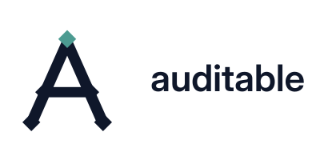
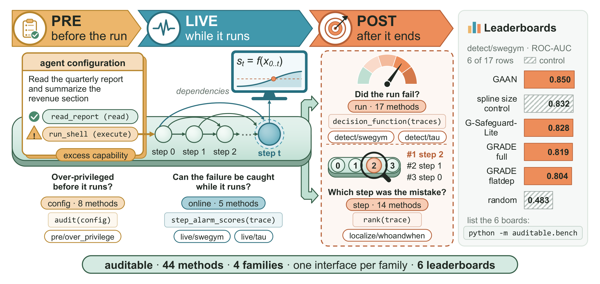
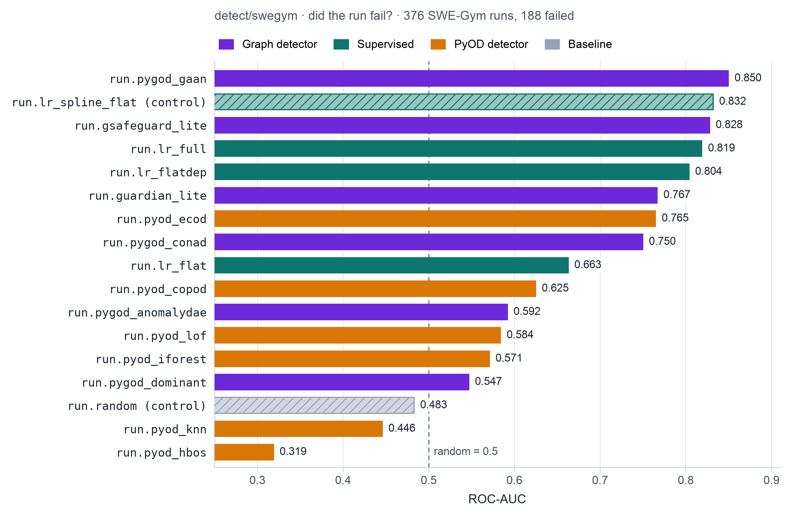

<div align="center">

<!-- logo-family -->
<picture>
  <source media="(prefers-color-scheme: dark)" srcset="https://raw.githubusercontent.com/yzhao062/auditable/main/docs/assets/brand/logo-dark.svg">
  
</picture>


# auditable

**Auditing methods for AI agents before, during, and after a run, with one interface per family and a leaderboard for every task.**

[](https://pypi.org/project/auditable/)
[](https://pypi.org/project/auditable/)
[](https://github.com/yzhao062/auditable/blob/main/LICENSE)
[](https://github.com/yzhao062/auditable/actions/workflows/ci.yml)

[Install](#install) · [Implemented Algorithms](#implemented-algorithms) · [Leaderboards](#leaderboards) · [Quick Start](#quick-start) · [API Cheatsheet](#api-cheatsheet) · [Real Agent Traces](#real-agent-traces) · [Adding a Method](#adding-a-method) · [Docs](https://auditable-ai.readthedocs.io/) · [Citation](#citation)

</div>

<p align="center"></p>

> **New in 0.4: leaderboards.** `python -m auditable.bench <task>` reruns one of six [CatchBench](https://github.com/yzhao062/catchbench) boards on your machine, and a method you write gets a rank on the same population and protocol ([Leaderboards](#leaderboards)).

`auditable` brings the PyOD pattern to agent auditing. Its methods read an agent configuration (before a run) or a trace, the list of steps the agent took (during and after it).

**Why auditable?**

* **Audit at each stage of a run.** PRE checks the configuration, LIVE watches the streaming run, and POST detects failed runs and ranks the decisive step.
* **One interface per family.** `get_method(id)()` creates any method. Methods with the same family and fit scope share their calls, so switching between them changes one string, in the way PyOD gives every outlier detector `fit` and `decision_function`.
* **Leaderboards on fixed tasks.** Each of the six tasks fixes its population, metric, and protocol, so the rows of different methods compare directly.
* **Literature baselines beside new methods.** PyOD and PyGOD detectors, GUARDIAN-Lite, G-Safeguard-Lite, the Who&When LLM judges, and OWASP-style rules are scored beside the methods of [GRADE](https://arxiv.org/abs/2606.22741) and [CatchBench](https://github.com/yzhao062/catchbench).
* **Real agent traces.** [agentpile](https://github.com/yzhao062/agentpile) adapters read public datasets, trace files, and captured runs into the inputs the methods consume.
* **Light core install.** `pip install auditable` has no third-party dependencies and already runs the configuration rules; the heavier methods sit behind extras.

The 44 methods fall into three stages and four families, because POST holds two:

| Stage | Question | Family | Interface | Methods | Leaderboards |
|---|---|---|---|---|---|
| PRE | Is the agent configuration over-privileged before it runs? | `config` | `audit(config)` | [8](#i-pre-configuration-auditors) | [`pre/over_privilege`](#leaderboards) |
| LIVE | Can the failure be caught while the run streams? | `online` | `step_alarm_scores(trace)` | [5](#ii-live-online-monitors) | [`live/swegym`, `live/tau`](#leaderboards) (run detectors are also scored on prefixes) |
| POST detection | Did the run fail? | `run` | `fit`, `decision_function` | [17](#iii-post-run-level-failure-detectors) | [`detect/swegym`](#leaderboards), [`detect/tau`](#leaderboards) |
| POST localization | Which step was the decisive mistake? | `step` | `rank(trace)` | [14](#iv-post-step-level-fault-locators) | [`localize/whoandwhen`](#leaderboards) |

## Install

```bash
pip install auditable             # core: registry and configuration rules, no third-party dependencies
pip install "auditable[bench]"    # adds the leaderboards
```

Other extras are `tabular-ad` (run, step, and online methods on trace features), `agentpile` (public datasets, trace files, and captured runs), and `graph-ad` (the graph methods, below); the [install guide](https://github.com/yzhao062/auditable/blob/main/docs/install.md) lists them with their dependencies.

<details>
<summary>Graph methods (PyGOD detectors, GUARDIAN-Lite, G-Safeguard-Lite): install torch and pyg-lib first</summary>

The graph methods need Python 3.10 or newer. Install torch and a matching PyG sampling backend (`pyg-lib`) before the extra, because pip cannot resolve that backend from the extra. The steps are the same on Linux, macOS on Apple silicon, and Windows:

```bash
pip install "torch==2.12.1" --index-url https://download.pytorch.org/whl/cpu
pip install pyg_lib -f https://data.pyg.org/whl/torch-2.12.1+cpu.html
pip install "auditable[graph-ad]"
python -c "import torch_geometric.typing as t; assert t.WITH_PYG_LIB"
```

Colab, which ships its own torch, and patch releases without `pyg-lib` wheels are covered in the [install guide](https://github.com/yzhao062/auditable/blob/main/docs/install.md).

</details>

**Audit Agent Runs with 5 Lines of Code** (`pip install "auditable[tabular-ad]"`):

```python
from auditable.datasets import make_traces
from auditable.methods import get_method
traces, y, mistakes = make_traces(n_runs=100, random_state=0)   # 100 toy agent runs, half of them failed
clf = get_method("run.lr_flatdep")().fit(traces[:50], y[:50])     # fit a run detector on 50 labelled runs
y_test_scores = clf.decision_function(traces[50:])                # one failure score per new run, higher = more likely failed
```

## Implemented Algorithms

The methods are organized by when they audit: **(i) PRE** configuration auditors, **(ii) LIVE** online monitors, **(iii) POST** run-level failure detectors, and **(iv) POST** step-level fault locators, followed by **(v) Utility Functions**. Configuration rules and the step-by-step and binary-search LLM judges run on the core install, graph detectors need the `graph-ad` extra, and every other method needs `tabular-ad`.

### (i) PRE: Configuration Auditors

`auditor.audit(config)` reads an `AgentConfig` (the declared capabilities and the task text) and returns a finding. Leaderboard: `pre/over_privilege`.

<!-- methods:config:start -->
| Type | Method | Algorithm | Year | Reference |
|---|---|---|---|---|
| Rule | `config.flag_risky_perms` | Flag risky permission levels | 2026 | [CatchBench](https://arxiv.org/abs/2608.22808) |
| Rule | `config.owasp_asi_combined` | Combined OWASP and CWE scanner | 2026 | [CatchBench](https://arxiv.org/abs/2608.22808) |
| Rule | `config.owasp_excess_functionality` | Excess functionality | 2026 | [CatchBench](https://arxiv.org/abs/2608.22808) |
| Rule | `config.owasp_excess_permissions` | Excess permission level | 2026 | [CatchBench](https://arxiv.org/abs/2608.22808) |
| Rule | `config.owasp_privilege_escalation` | Unrequested privilege management | 2026 | [CatchBench](https://arxiv.org/abs/2608.22808) |
| Rule | `config.sensitive_access` | Unrequested sensitive access | 2026 | [CatchBench](https://arxiv.org/abs/2608.22808) |
| Rule | `config.unrequested_high_impact` | Unrequested high-impact action | 2026 | [CatchBench](https://arxiv.org/abs/2608.22808) |
| LLM judge | `config.llm_needed` | LLM judge, needed capabilities | 2026 | [CatchBench](https://arxiv.org/abs/2608.22808) |
<!-- methods:config:end -->

### (ii) LIVE: Online Monitors

`monitor.step_alarm_scores(trace)` returns one alarm per step. A dependency is an earlier step that the current step relies on, and the span measures how far back the earliest dependency lies. The run detectors of (iii) also take part in the LIVE leaderboards, scored on prefixes of the run. Leaderboards: `live/swegym`, `live/tau`.

<!-- methods:online:start -->
| Type | Method | Algorithm | Year | Reference |
|---|---|---|---|---|
| Rule | `online.dep_count_z` | Causal z-score of dependency count | 2026 | [CatchBench](https://arxiv.org/abs/2608.22808) |
| Rule | `online.dep_span` | Mean dependency span (running) | 2026 | [CatchBench](https://arxiv.org/abs/2608.22808) |
| Rule | `online.raw_span` | Raw dependency span | 2026 | [CatchBench](https://arxiv.org/abs/2608.22808) |
| Rule | `online.span_z` | Causal z-score of dependency span | 2026 | [CatchBench](https://arxiv.org/abs/2608.22808) |
| Baseline | `online.random` | Random alarm scores | 2026 | [CatchBench](https://arxiv.org/abs/2608.22808) |
<!-- methods:online:end -->

### (iii) POST: Run-Level Failure Detectors

`detector.fit(traces, y)`, then `detector.decision_function(traces)`; transductive detectors use `detector.fit_score(traces)`. Leaderboards: `detect/swegym`, `detect/tau`.

<!-- methods:run:start -->
| Type | Method | Algorithm | Year | Reference |
|---|---|---|---|---|
| Supervised | `run.lr_flat` | Logistic regression on run size (GRADE flat) | 2026 | [GRADE (Zhao)](https://arxiv.org/abs/2606.22741) |
| Supervised | `run.lr_flatdep` | Logistic regression on size and dependency (GRADE flatdep) | 2026 | [GRADE (Zhao)](https://arxiv.org/abs/2606.22741) |
| Supervised | `run.lr_full` | Logistic regression on all raw layers (GRADE full) | 2026 | [GRADE (Zhao)](https://arxiv.org/abs/2606.22741) |
| Supervised | `run.lr_spline_flat` | Logistic regression on a cubic spline of run size (flexible size control) | 2026 | [CatchBench](https://arxiv.org/abs/2608.22808) |
| PyOD detector | `run.pyod_copod` | COPOD on run size | 2020 | [COPOD (Li et al.)](https://arxiv.org/abs/2009.09463) |
| PyOD detector | `run.pyod_ecod` | ECOD on run size | 2022 | [ECOD (Li et al.)](https://arxiv.org/abs/2201.00382) |
| PyOD detector | `run.pyod_hbos` | HBOS on run size | 2012 | [HBOS (Goldstein and Dengel)](https://www.dfki.de/web/forschung/projekte-publikationen/publikation/6431) |
| PyOD detector | `run.pyod_iforest` | Isolation Forest on run size | 2008 | [Isolation Forest (Liu et al.)](https://doi.org/10.1109/ICDM.2008.17) |
| PyOD detector | `run.pyod_knn` | KNN distance on run size | 2000 | [KNN outlier score (Ramaswamy et al.)](https://doi.org/10.1145/335191.335437) |
| PyOD detector | `run.pyod_lof` | Local outlier factor on run size | 2000 | [LOF (Breunig et al.)](https://doi.org/10.1145/335191.335388) |
| Graph detector | `run.gsafeguard_lite` | G-Safeguard-Lite (supervised graph classifier) | 2025 | [G-Safeguard (Wang et al.)](https://arxiv.org/abs/2502.11127) |
| Graph detector | `run.guardian_lite` | GUARDIAN-Lite (attribute-reconstruction autoencoder) | 2025 | [GUARDIAN (Zhou et al.)](https://arxiv.org/abs/2505.19234) |
| Graph detector | `run.pygod_anomalydae` | AnomalyDAE dual autoencoder (PyGOD) | 2020 | [AnomalyDAE (Fan et al.)](https://arxiv.org/abs/2002.03665) |
| Graph detector | `run.pygod_conad` | CONAD contrastive graph autoencoder (PyGOD) | 2022 | [CONAD (Xu et al.)](https://doi.org/10.1007/978-3-031-05936-0_35) |
| Graph detector | `run.pygod_dominant` | DOMINANT graph autoencoder (PyGOD) | 2019 | [DOMINANT (Ding et al.)](https://doi.org/10.1137/1.9781611975673.67) |
| Graph detector | `run.pygod_gaan` | GAAN adversarial detector (PyGOD) | 2020 | [GAAN (Chen et al.)](https://doi.org/10.1145/3340531.3412070) |
| Baseline | `run.random` | Random run scores | 2026 | [CatchBench](https://arxiv.org/abs/2608.22808) |
<!-- methods:run:end -->

### (iv) POST: Step-Level Fault Locators

`locator.rank(trace)` orders the steps of a failed run, most suspected first; supervised locators are fitted first with `fit(traces, y)`. The two transductive graph locators score a batch with `fit_step_scores(traces)`, and the step-by-step and binary-search LLM judges name one step with `predict_step(trace)`. The blast radius of a step is the number of later steps that transitively depend on it. Leaderboard: `localize/whoandwhen`.

<!-- methods:step:start -->
| Type | Method | Algorithm | Year | Reference |
|---|---|---|---|---|
| Rule | `step.blast` | Blast radius (downstream reach) | 2026 | [CatchBench](https://arxiv.org/abs/2608.22808) |
| Rule | `step.degree` | Dependency degree | 2026 | [CatchBench](https://arxiv.org/abs/2608.22808) |
| Rule | `step.dep_anomaly` | Dependency anomaly (within-run z-score) | 2026 | [CatchBench](https://arxiv.org/abs/2608.22808) |
| Rule | `step.has_dep` | Has a dependency | 2026 | [CatchBench](https://arxiv.org/abs/2608.22808) |
| Rule | `step.max_span` | Maximum dependency span | 2026 | [CatchBench](https://arxiv.org/abs/2608.22808) |
| Rule | `step.position_early_rule` | Early-position prior | 2026 | [CatchBench](https://arxiv.org/abs/2608.22808) |
| Supervised | `step.exec_rank` | Execution-feature step ranker | 2026 | [GRADE (Zhao)](https://arxiv.org/abs/2606.22741) |
| Supervised | `step.position_supervised` | Early-fault position prior | 2026 | [GRADE (Zhao)](https://arxiv.org/abs/2606.22741) |
| Graph detector | `step.pygod_dominant_sg4` | DOMINANT on the step dependency graph | 2019 | [DOMINANT (Ding et al.)](https://doi.org/10.1137/1.9781611975673.67) |
| Graph detector | `step.pygod_dominant_ww8` | DOMINANT on the Who&When step matrix | 2019 | [DOMINANT (Ding et al.)](https://doi.org/10.1137/1.9781611975673.67) |
| LLM judge | `step.llm_all_at_once` | LLM judge, all-at-once | 2025 | [Who&When (Zhang et al.)](https://arxiv.org/abs/2505.00212) |
| LLM judge | `step.llm_binary_search` | LLM judge, binary-search | 2025 | [Who&When (Zhang et al.)](https://arxiv.org/abs/2505.00212) |
| LLM judge | `step.llm_step_by_step` | LLM judge, step-by-step | 2025 | [Who&When (Zhang et al.)](https://arxiv.org/abs/2505.00212) |
| Baseline | `step.random` | Random step scores | 2026 | [CatchBench](https://arxiv.org/abs/2608.22808) |
<!-- methods:step:end -->

<details>
<summary><b>(v) Utility Functions</b>: data loaders, adapters, featurizers, benchmark, registry, and LLM backend</summary>

| Type | Name | Function |
|---|---|---|
| Data | `auditable.datasets.make_traces` | Generate toy traces with one planted mistake in each failed run |
| Data | `auditable.datasets.load_traces` | Load a public dataset (Who&When, tau-bench, SWE-Gym, and others) as traces, run labels, and mistake steps |
| Adapter | `auditable.from_agentpile` | Convert agentpile records into the traces every method reads |
| Adapter | `auditable.configs_from_agentpile` | Convert agentpile records into the configurations the config methods read |
| Adapter | `auditable.run_targets`, `auditable.step_targets` | Run labels (1 failed, 0 succeeded, -1 unknown) and decisive-mistake step labels (-1 where there is none) from traces |
| Featurize | `auditable.featurize.AgentConfig` | The declared capabilities and task text that a configuration auditor reads |
| Featurize | `auditable.featurize.grade_layer_matrix` | One GRADE structural layer of each trace as an (n_traces, n_features) array |
| Featurize | `auditable.featurize.who_when_step_matrix` | The Who&When step features of one trace, one row per step |
| Featurize | `auditable.featurize.step_graph` | Per-step features and dependency edges of one trace |
| Featurize | `auditable.featurize.to_pyg` | Encode a typed graph as the node features and edge index PyGOD reads |
| Benchmark | `auditable.bench.leaderboard` | Score methods on a task and return a ranked `Board` |
| Registry | `auditable.methods.get_method`, `auditable.methods.list_methods`, `auditable.methods.method_table` | The method class registered under an id, the method cards filtered by family, information state (`PRE`, `LIVE`, or `POST`), or fit scope, and the registry as a Markdown table (`method_table(detailed=True)` returns the fit scope, fidelity to the source, extras, and CatchBench row of each method) |
| LLM backend | `auditable.llm.OpenAICompatibleBackend` | Reach an OpenAI-compatible endpoint with the standard library alone; the LLM judges accept any `prompt -> reply` function |

</details>

## Leaderboards

`auditable.bench` scores the methods on six tasks, one board per task, on the populations and protocols of the CatchBench boards (arXiv:2608.22808). A task fixes its data and its protocol, so every method on a board is scored the same way.

<p align="center"></p>

PyGOD's GAAN, a method from the literature, leads at about 0.85 ROC-AUC. Run size alone, fitted with a cubic spline (`run.lr_spline_flat`, a control), follows at about 0.83, above G-Safeguard-Lite and both GRADE dependency regressions, so read a new row against the size baselines `run.lr_flat` and `run.lr_spline_flat`.

| Stage | Task | Population | Metric |
|---|---|---|---|
| PRE | `pre/over_privilege` | 1,187 configurations from six sources | F1 (overall and per source), precision, recall, coverage |
| LIVE | `live/swegym` | SWE-Gym runs, read as prefixes of 25, 50, 75, and 100 percent of their steps | mean prefix ROC-AUC |
| LIVE | `live/tau` | tau-bench runs, read as prefixes of 25, 50, 75, and 100 percent of their steps | mean prefix ROC-AUC |
| POST | `detect/swegym` | SWE-Gym OpenHands, one scaffold: 376 runs, 188 failed | ROC-AUC |
| POST | `detect/tau` | tau-bench: 660 runs, 363 failed | ROC-AUC |
| POST | `localize/whoandwhen` | Who&When: 126 failed multi-agent runs with a labeled mistake step | top-1, top-3, MRR (mean reciprocal rank) |

```bash
pip install "auditable[bench]"
python -m auditable.bench                                                    # list the tasks
python -m auditable.bench detect/swegym                                      # rerun one board
python -m auditable.bench detect/swegym --methods run.lr_flat run.pyod_ecod  # score chosen rows only
python -m auditable.bench detect/swegym --golden --allow-skipped             # exit 1 if a scored row differs from the CatchBench board
python -m auditable.bench detect/swegym --markdown                           # a Markdown table; --json prints JSON
```

The notebook [`examples/leaderboard.ipynb`](https://github.com/yzhao062/auditable/blob/main/examples/leaderboard.ipynb) reruns the boards in a browser: [](https://colab.research.google.com/github/yzhao062/auditable/blob/main/examples/leaderboard.ipynb)

The first run downloads the data through agentpile, and the LLM judges on the `pre` and `localize` boards replay committed caches, so no board needs an API call. Graph rows need `auditable[graph-ad]` ([Install](#install)) and are listed as skipped without it, which `--allow-skipped` lets `--golden` accept.

### The Six Boards

All six boards start folded; open a summary line for its table. Every row names its method's Type and Algorithm, as in the tables above. A `(control)` row is a floor such as random scores or run size alone, and an `(oracle)` row is an upper bound that reads the labels. On the two LIVE boards, the Stage column separates LIVE monitors (`online.`) from POST run detectors (`run.`) scored on prefixes of the run.

<details>
<summary><b>POST</b>: <code>detect/swegym</code>, run-level detection on SWE-Gym (ROC-AUC), the full table of the chart above with Type and Algorithm</summary>

<!-- board:detect/swegym:start -->
| Rank | Type | Method | Algorithm | roc_auc |
|---|---|---|---|---|
| 1 | Graph detector | `run.pygod_gaan` | GAAN adversarial detector (PyGOD) | 0.850 |
| 2 | Supervised | `run.lr_spline_flat` (control) | Logistic regression on a cubic spline of run size (flexible size control) | 0.832 |
| 3 | Graph detector | `run.gsafeguard_lite` | G-Safeguard-Lite (supervised graph classifier) | 0.828 |
| 4 | Supervised | `run.lr_full` | Logistic regression on all raw layers (GRADE full) | 0.819 |
| 5 | Supervised | `run.lr_flatdep` | Logistic regression on size and dependency (GRADE flatdep) | 0.804 |
| 6 | Graph detector | `run.guardian_lite` | GUARDIAN-Lite (attribute-reconstruction autoencoder) | 0.767 |
| 7 | PyOD detector | `run.pyod_ecod` | ECOD on run size | 0.765 |
| 8 | Graph detector | `run.pygod_conad` | CONAD contrastive graph autoencoder (PyGOD) | 0.750 |
| 9 | Supervised | `run.lr_flat` | Logistic regression on run size (GRADE flat) | 0.663 |
| 10 | PyOD detector | `run.pyod_copod` | COPOD on run size | 0.625 |
| 11 | Graph detector | `run.pygod_anomalydae` | AnomalyDAE dual autoencoder (PyGOD) | 0.592 |
| 12 | PyOD detector | `run.pyod_lof` | Local outlier factor on run size | 0.584 |
| 13 | PyOD detector | `run.pyod_iforest` | Isolation Forest on run size | 0.571 |
| 14 | Graph detector | `run.pygod_dominant` | DOMINANT graph autoencoder (PyGOD) | 0.547 |
| 15 | Baseline | `run.random` (control) | Random run scores | 0.483 |
| 16 | PyOD detector | `run.pyod_knn` | KNN distance on run size | 0.446 |
| 17 | PyOD detector | `run.pyod_hbos` | HBOS on run size | 0.319 |
<!-- board:detect/swegym:end -->

The spline control `run.lr_spline_flat` fits a cubic spline to the same four run-size counts that the linear size baseline `run.lr_flat` reads (its reference value comes from CatchBench's size audit, since the CatchBench board has no such row). Run size alone, fitted without a linear restriction, ranks above G-Safeguard-Lite and both GRADE dependency regressions, so this board does not show that dependency structure predicts failure beyond size. On tau-bench the order changes, and `run.lr_flatdep` (0.665) ranks above the spline control (0.631).

On macOS arm64, `--golden` accepts three platform values: `run.pyod_lof` on this board (0.582 instead of 0.584), and `run.pyod_knn` (0.574 instead of 0.575) and `run.pygod_anomalydae` (0.529 instead of 0.490) on `detect/tau`.

</details>

<details>
<summary><b>PRE</b>: <code>pre/over_privilege</code>, over-privileged configurations (F1)</summary>

<!-- board:pre/over_privilege:start -->
| Rank | Type | Method | Algorithm | f1 | precision | recall | coverage | f1@crewai | f1@n8n | f1@mcp | f1@injecagent | f1@sweagent | f1@synthetic |
|---|---|---|---|---|---|---|---|---|---|---|---|---|---|
| 1 | LLM judge | `config.llm_needed(llama-3.3-70b)` | LLM judge, needed capabilities | 0.695 | 0.594 | 0.839 | 0.996 | 0.518 | 0.362 | 0.744 | 0.990 | 0.467 | 0.972 |
| 2 | Rule | `config.owasp_asi_combined` | Combined OWASP and CWE scanner | 0.654 | 0.511 | 0.910 | 1.000 | 0.448 | 0.411 | 0.644 | 0.961 | 0.570 | 0.842 |
| 3 | Rule | `config.owasp_excess_functionality` | Excess functionality | 0.642 | 0.538 | 0.796 | 1.000 | 0.451 | 0.514 | 0.632 | 0.957 | 0.574 | 0.539 |
| 4 | Baseline | `config.flag_all` (control) | Flag all capabilities | 0.601 | 0.430 | 1.000 | 1.000 | 0.388 | 0.154 | 0.654 | 0.750 | 0.574 | 0.763 |
| 5 | Rule | `config.owasp_excess_permissions` | Excess permission level | 0.505 | 0.504 | 0.506 | 1.000 | 0.327 | 0.052 | 0.566 | 0.801 | 0.007 | 0.825 |
| 6 | Rule | `config.flag_risky_perms` | Flag risky permission levels | 0.480 | 0.418 | 0.564 | 1.000 | 0.326 | 0.095 | 0.575 | 0.827 | 0.025 | 0.803 |
| 7 | Rule | `config.unrequested_high_impact` | Unrequested high-impact action | 0.240 | 0.633 | 0.148 | 1.000 | 0.066 | 0.041 | 0.211 | 0.605 | 0.000 | 0.248 |
| 8 | Rule | `config.sensitive_access` | Unrequested sensitive access | 0.030 | 0.763 | 0.016 | 1.000 | 0.014 | 0.000 | 0.058 | 0.000 | 0.000 | 0.000 |
| 9 | Rule | `config.owasp_privilege_escalation` | Unrequested privilege management | 0.020 | 0.811 | 0.010 | 1.000 | 0.000 | 0.000 | 0.018 | 0.065 | 0.000 | 0.000 |
| 10 | Baseline | `config.flag_none` (control) | Flag no capabilities | 0.000 | 0.000 | 0.000 | 1.000 | 0.000 | 0.000 | 0.000 | 0.000 | 0.000 | 0.000 |
| ref | Oracle | `config.oracle_privilege_diff` (oracle) | Privilege-diff oracle | 1.000 | 1.000 | 1.000 | 1.000 | 1.000 | 1.000 | 1.000 | 1.000 | 1.000 | 1.000 |
<!-- board:pre/over_privilege:end -->

The best rule scanner (F1 about 0.65) and an LLM judge (about 0.70) edge out flagging every configuration (0.60), so read F1 beside precision and recall. Coverage is the share of configurations a method judged, and the oracle row reads the labels, so the board lists it apart as an upper bound.

</details>

<details>
<summary><b>LIVE</b>: <code>live/swegym</code>, early warning on SWE-Gym (mean prefix ROC-AUC)</summary>

<!-- board:live/swegym:start -->
| Rank | Stage | Type | Method | Algorithm | prefix_auc | auc@25 | auc@50 | auc@75 | auc@100 |
|---|---|---|---|---|---|---|---|---|---|
| 1 | POST | Supervised | `run.lr_spline_flat` (control) | Logistic regression on a cubic spline of run size (flexible size control) | 0.822 | 0.808 | 0.821 | 0.827 | 0.832 |
| 2 | POST | Supervised | `run.lr_full` | Logistic regression on all raw layers (GRADE full) | 0.818 | 0.813 | 0.816 | 0.826 | 0.819 |
| 3 | POST | Supervised | `run.lr_flatdep` | Logistic regression on size and dependency (GRADE flatdep) | 0.779 | 0.742 | 0.766 | 0.804 | 0.804 |
| 4 | POST | PyOD detector | `run.pyod_ecod` | ECOD on run size | 0.763 | 0.756 | 0.762 | 0.767 | 0.765 |
| 5 | POST | Supervised | `run.lr_flat` | Logistic regression on run size (GRADE flat) | 0.657 | 0.629 | 0.663 | 0.673 | 0.663 |
| 6 | LIVE | Rule | `online.dep_span` | Mean dependency span (running) | 0.534 | 0.364 | 0.534 | 0.589 | 0.648 |
| 7 | POST | Baseline | `run.random` (control) | Random run scores | 0.483 | 0.483 | 0.483 | 0.483 | 0.483 |
<!-- board:live/swegym:end -->

</details>

<details>
<summary><b>LIVE</b>: <code>live/tau</code>, early warning on tau-bench (mean prefix ROC-AUC)</summary>

<!-- board:live/tau:start -->
| Rank | Stage | Type | Method | Algorithm | prefix_auc | auc@25 | auc@50 | auc@75 | auc@100 |
|---|---|---|---|---|---|---|---|---|---|
| 1 | POST | Supervised | `run.lr_full` | Logistic regression on all raw layers (GRADE full) | 0.645 | 0.642 | 0.628 | 0.644 | 0.665 |
| 2 | POST | Supervised | `run.lr_flatdep` | Logistic regression on size and dependency (GRADE flatdep) | 0.639 | 0.632 | 0.617 | 0.640 | 0.665 |
| 3 | POST | Supervised | `run.lr_spline_flat` (control) | Logistic regression on a cubic spline of run size (flexible size control) | 0.627 | 0.628 | 0.615 | 0.635 | 0.631 |
| 4 | POST | Supervised | `run.lr_flat` | Logistic regression on run size (GRADE flat) | 0.622 | 0.632 | 0.618 | 0.620 | 0.619 |
| 5 | POST | PyOD detector | `run.pyod_ecod` | ECOD on run size | 0.554 | 0.546 | 0.553 | 0.562 | 0.555 |
| 6 | LIVE | Rule | `online.dep_span` | Mean dependency span (running) | 0.541 | 0.503 | 0.530 | 0.565 | 0.568 |
| 7 | POST | Baseline | `run.random` (control) | Random run scores | 0.498 | 0.498 | 0.498 | 0.498 | 0.498 |
<!-- board:live/tau:end -->

</details>

<details>
<summary><b>POST</b>: <code>detect/tau</code>, run-level detection on tau-bench (ROC-AUC)</summary>

<!-- board:detect/tau:start -->
| Rank | Type | Method | Algorithm | roc_auc |
|---|---|---|---|---|
| 1 | Supervised | `run.lr_flatdep` | Logistic regression on size and dependency (GRADE flatdep) | 0.665 |
| 1 | Supervised | `run.lr_full` | Logistic regression on all raw layers (GRADE full) | 0.665 |
| 3 | Supervised | `run.lr_spline_flat` (control) | Logistic regression on a cubic spline of run size (flexible size control) | 0.631 |
| 4 | Graph detector | `run.gsafeguard_lite` | G-Safeguard-Lite (supervised graph classifier) | 0.626 |
| 5 | Supervised | `run.lr_flat` | Logistic regression on run size (GRADE flat) | 0.619 |
| 6 | PyOD detector | `run.pyod_copod` | COPOD on run size | 0.593 |
| 7 | PyOD detector | `run.pyod_knn` | KNN distance on run size | 0.575 |
| 8 | PyOD detector | `run.pyod_hbos` | HBOS on run size | 0.562 |
| 9 | PyOD detector | `run.pyod_iforest` | Isolation Forest on run size | 0.561 |
| 10 | PyOD detector | `run.pyod_ecod` | ECOD on run size | 0.555 |
| 11 | Graph detector | `run.pygod_conad` | CONAD contrastive graph autoencoder (PyGOD) | 0.552 |
| 12 | Graph detector | `run.pygod_dominant` | DOMINANT graph autoencoder (PyGOD) | 0.550 |
| 13 | Graph detector | `run.guardian_lite` | GUARDIAN-Lite (attribute-reconstruction autoencoder) | 0.542 |
| 14 | Graph detector | `run.pygod_gaan` | GAAN adversarial detector (PyGOD) | 0.517 |
| 15 | PyOD detector | `run.pyod_lof` | Local outlier factor on run size | 0.504 |
| 16 | Baseline | `run.random` (control) | Random run scores | 0.498 |
| 17 | Graph detector | `run.pygod_anomalydae` | AnomalyDAE dual autoencoder (PyGOD) | 0.490 |
<!-- board:detect/tau:end -->

`run.lr_flatdep` and `run.lr_full` lead the board, tied at 0.665, against 0.619 for the linear size baseline `run.lr_flat`.

</details>

<details>
<summary><b>POST</b>: <code>localize/whoandwhen</code>, decisive-mistake localization (top-1, top-3, MRR)</summary>

<!-- board:localize/whoandwhen:start -->
| Rank | Type | Method | Algorithm | top1 | top3 | mrr |
|---|---|---|---|---|---|---|
| 1 | LLM judge | `llm-judge all-at-once (gpt-5.5)` | LLM judge, all-at-once | 0.452 | 0.667 | 0.618 |
| 2 | LLM judge | `llm-judge all-at-once (claude-opus-4.8)` | LLM judge, all-at-once | 0.421 | 0.698 | 0.605 |
| 2 | LLM judge | `llm-judge binary-search (gpt-5.5)` | LLM judge, binary-search | 0.421 | 0.421 | 0.421 |
| 4 | LLM judge | `llm-judge all-at-once (gpt-5.4)` | LLM judge, all-at-once | 0.413 | 0.714 | 0.601 |
| 5 | LLM judge | `llm-judge all-at-once (deepseek-r1)` | LLM judge, all-at-once | 0.405 | 0.754 | 0.606 |
| 5 | LLM judge | `llm-judge binary-search (deepseek-r1)` | LLM judge, binary-search | 0.405 | 0.405 | 0.405 |
| 7 | LLM judge | `llm-judge step-by-step (gpt-5.5)` | LLM judge, step-by-step | 0.397 | 0.397 | 0.397 |
| 8 | LLM judge | `llm-judge step-by-step (claude-opus-4.8)` | LLM judge, step-by-step | 0.389 | 0.389 | 0.389 |
| 9 | LLM judge | `llm-judge step-by-step (gpt-5.4)` | LLM judge, step-by-step | 0.381 | 0.381 | 0.381 |
| 10 | LLM judge | `llm-judge binary-search (gpt-5.4)` | LLM judge, binary-search | 0.365 | 0.365 | 0.365 |
| 11 | LLM judge | `llm-judge all-at-once (gemini)` | LLM judge, all-at-once | 0.357 | 0.722 | 0.572 |
| 11 | LLM judge | `llm-judge binary-search (claude-opus-4.8)` | LLM judge, binary-search | 0.357 | 0.357 | 0.357 |
| 11 | LLM judge | `llm-judge binary-search (gemini)` | LLM judge, binary-search | 0.357 | 0.357 | 0.357 |
| 14 | LLM judge | `llm-judge all-at-once (qwen3-32b)` | LLM judge, all-at-once | 0.349 | 0.659 | 0.541 |
| 15 | LLM judge | `llm-judge step-by-step (gemini)` | LLM judge, step-by-step | 0.341 | 0.341 | 0.341 |
| 16 | LLM judge | `llm-judge all-at-once (gpt-oss-20b)` | LLM judge, all-at-once | 0.333 | 0.595 | 0.521 |
| 16 | LLM judge | `llm-judge all-at-once (llama-3.3-70b)` | LLM judge, all-at-once | 0.333 | 0.579 | 0.515 |
| 18 | LLM judge | `llm-judge step-by-step (deepseek-r1)` | LLM judge, step-by-step | 0.317 | 0.317 | 0.317 |
| 19 | LLM judge | `llm-judge step-by-step (qwen3-32b)` | LLM judge, step-by-step | 0.254 | 0.254 | 0.254 |
| 20 | LLM judge | `llm-judge step-by-step (gemma-3-12b)` | LLM judge, step-by-step | 0.230 | 0.230 | 0.230 |
| 21 | LLM judge | `llm-judge binary-search (llama-3.3-70b)` | LLM judge, binary-search | 0.222 | 0.222 | 0.222 |
| 21 | LLM judge | `llm-judge step-by-step (llama-3.3-70b)` | LLM judge, step-by-step | 0.222 | 0.222 | 0.222 |
| 23 | LLM judge | `llm-judge binary-search (mistral-small)` | LLM judge, binary-search | 0.214 | 0.214 | 0.214 |
| 24 | Supervised | `exec-rank (sup.)` | Execution-feature step ranker | 0.211 | 0.614 | 0.454 |
| 25 | LLM judge | `llm-judge all-at-once (gemma-3-12b)` | LLM judge, all-at-once | 0.206 | 0.524 | 0.427 |
| 26 | LLM judge | `llm-judge step-by-step (mistral-small)` | LLM judge, step-by-step | 0.190 | 0.190 | 0.190 |
| 27 | LLM judge | `llm-judge binary-search (nova-micro)` | LLM judge, binary-search | 0.167 | 0.167 | 0.167 |
| 27 | LLM judge | `llm-judge step-by-step (nova-micro)` | LLM judge, step-by-step | 0.167 | 0.167 | 0.167 |
| 29 | Rule | `auditable (blast)` | Blast radius (downstream reach) | 0.159 | 0.516 | 0.407 |
| 29 | LLM judge | `llm-judge binary-search (gemma-3-12b)` | LLM judge, binary-search | 0.159 | 0.159 | 0.159 |
| 29 | Supervised | `position` | Early-fault position prior | 0.159 | 0.516 | 0.407 |
| 32 | LLM judge | `llm-judge all-at-once (mistral-small)` | LLM judge, all-at-once | 0.135 | 0.421 | 0.363 |
| 33 | LLM judge | `llm-judge all-at-once (nova-micro)` | LLM judge, all-at-once | 0.127 | 0.397 | 0.342 |
| 33 | LLM judge | `llm-judge binary-search (qwen3-32b)` | LLM judge, binary-search | 0.127 | 0.127 | 0.127 |
| 35 | Baseline | `random` (control) | Random step scores | 0.119 | 0.346 | 0.324 |
| 36 | Graph detector | `pygod (graph AD)` | DOMINANT on the Who&When step matrix | 0.048 | 0.302 | 0.258 |
<!-- board:localize/whoandwhen:end -->

The best all-at-once LLM judges reach top-1 of about 0.4, against 0.12 for random scores, and the blast rule ties the position prior. This board keeps the CatchBench labels: `auditable (blast)` is `step.blast`, `position` is `step.position_supervised`, `exec-rank (sup.)` is `step.exec_rank`, `pygod (graph AD)` is `step.pygod_dominant_ww8`, and each `llm-judge <protocol> (<model>)` row is `step.llm_<protocol>` replaying the cached answers of that model.

</details>

### Put Your Method on the Board

A method is a class with a `MethodCard` that follows the [method contract](https://github.com/yzhao062/auditable/blob/main/docs/methods-contract.md). Pass it as `extra=` and `leaderboard` scores it beside the default rows under the protocol of its kind: cross-validation for a supervised detector, and a single `fit_score` over the whole population for an unsupervised one. The snippet adds a random forest on run size, a deliberately plain method:

```python
from sklearn.ensemble import RandomForestClassifier

from auditable.base import BaseRunDetector, MethodCard
from auditable.bench import leaderboard
from auditable.featurize import grade_layer_matrix


class ForestOnSize(BaseRunDetector):
    card = MethodCard(method_id="run.forest_flat", name="Random forest on run size", family="run",
                      fit_scope="inductive", supervised=True, output_kind="score", fidelity="original")

    def fit(self, runs, y=None):
        self.model_ = RandomForestClassifier(200, random_state=0)
        self.model_.fit(grade_layer_matrix(list(runs), "flat"), y)
        self.decision_scores_ = self.decision_function(runs)
        return self

    def decision_function(self, runs):
        return self.model_.predict_proba(grade_layer_matrix(list(runs), "flat"))[:, 1]


board = leaderboard("detect/swegym", extra=[ForestOnSize])
print(board.rank_of("run.forest_flat"), board["run.forest_flat"].scores)
```

The last line prints the rank of the new row among all rows and its scores. `print(board)` shows the full table, with your row under Type `Custom`. Variants, subsets, exports, and the steps for submitting a method are in the [leaderboard guide](https://github.com/yzhao062/auditable/blob/main/docs/leaderboard.md).

## Quick Start

Install with `pip install "auditable[tabular-ad]"` ([Install](#install)), then audit toy runs with a detector, a locator, and a monitor:

```python
from sklearn.metrics import roc_auc_score

from auditable.datasets import make_traces
from auditable.methods import get_method

# 100 toy agent runs; each failed run holds one stale read (a step relying on old state)
traces, y, mistakes = make_traces(n_runs=100, contamination=0.5, random_state=0)
train, test = slice(0, 50), slice(50, 100)

# Did the run fail? Fit on labelled runs, then score new ones, as with a PyOD detector.
detector = get_method("run.lr_flatdep")()
detector.fit(traces[train], y[train])
scores = detector.decision_function(traces[test])   # one score per run, higher = more likely failed
print(f"run-level ROC-AUC: {roc_auc_score(y[test], scores):.3f}")

# Which step was the mistake? Rank the steps of each failed run, most suspected first.
locator = get_method("step.dep_anomaly")()
failed = [i for i in range(100) if y[i] == 1]
hits = sum(locator.rank(traces[i])[0] == mistakes[i] for i in failed)
print(f"mistake ranked first in {hits} of {len(failed)} failed runs")

# Can it be caught live? One causal alarm per arriving step (step t sees steps 0..t only).
monitor = get_method("online.span_z")()
alarms = monitor.step_alarm_scores(traces[failed[0]])
print(f"first alarm peak at step {alarms.argmax()}, mistake at step {mistakes[failed[0]]}")
```

Sample output:

```text
run-level ROC-AUC: 0.998
mistake ranked first in 50 of 50 failed runs
first alarm peak at step 12, mistake at step 12
```

Before the run, a configuration auditor reads the declared capabilities and the task text. It needs no extra and flags the shell tool that the task does not call for:

```python
from auditable.featurize import AgentConfig
from auditable.methods import get_method

config = AgentConfig(
    declared_capabilities=[{"name": "read_report", "type": "tool", "permission_level": "read"},
                           {"name": "run_shell", "type": "tool", "permission_level": "execute"}],
    task_or_role_spec="Read the quarterly report and summarize the revenue section.",
)
finding = get_method("config.owasp_asi_combined")().audit(config)
print(finding.flag, sorted(finding.excess))   # True ['run_shell']
```

Methods with the same family and fit scope share an interface, so trying another detector or locator changes one string. [`examples/example_methods.py`](https://github.com/yzhao062/auditable/blob/main/examples/example_methods.py) runs one method from each family, and [`examples/README.md`](https://github.com/yzhao062/auditable/blob/main/examples/README.md) lists the other examples.

## API Cheatsheet

Every method is created from its id with `get_method(id)()`. Its entry points depend on its family:

* **audit(config)**: Audit one agent configuration before it runs (`config` family); returns a `ConfigFinding` with `flag`, `excess`, and `rules`.
* **step_alarm_scores(trace)**: Score each step of a streaming run with an alarm that reads steps 0 to t only (`online` family).
* **fit(traces, y)**: Fit a run detector or a step locator. The parameter y is ignored in unsupervised methods.
* **decision_function(traces)**: Predict one failure score per run using the fitted detector, higher meaning more likely failed.
* **fit_score(traces)**: Fit on one batch and return its scores, the only entry point of transductive detectors (the PyGOD detectors and GUARDIAN-Lite).
* **rank(trace)**: Order the steps of a failed run, most suspected first, using a step locator; transductive graph locators use `fit_step_scores(traces)`, and the single-answer LLM judges use `predict_step(trace)`.
* **get_method(id)** and **list_methods(family=None)**: Get the method class registered under an id, and list the method cards, optionally for one family.
* **leaderboard(task, methods=None, extra=())**: Score methods on a task and return a ranked `Board`. `python -m auditable.bench <task>` prints it from a shell.

**Key attributes of a fitted detector**: `decision_scores_` holds the failure scores of the fitted batch, higher meaning more likely failed.

The [method contract](https://github.com/yzhao062/auditable/blob/main/docs/methods-contract.md) defines the rest (`step_scores_batch`, `prefix_score`, `predict_step`, `audit_many`) and the inputs and outputs of every call.

## Real Agent Traces

[agentpile](https://github.com/yzhao062/agentpile) loads public agent-trace datasets (Who&When, TRAIL, MAST, tau-bench, SWE-Gym and others), trace files (OpenAI-style messages, OTLP JSON, Claude Code sessions, MCP tool lists) and captured runs into one record. `from_agentpile` turns those records into the traces every method reads, and `configs_from_agentpile` turns them into the configurations the config methods read. The example needs `pip install "auditable[agentpile,tabular-ad]"`.

<details>
<summary>Example: tau-bench runs, Who&amp;When steps, and MCP tool lists through agentpile</summary>

```python
import agentpile as ap
import auditable as au
from auditable.datasets import load_traces
from auditable.methods import get_method

# Any run: name the dependency rules, since agentpile infers none when it loads.
runs = list(ap.load("tau_bench", limit=100))
traces = au.from_agentpile(runs, deps=["tool_call_id_v1", "value_flow_v1"])
scores = get_method("run.pyod_ecod")().fit_score(traces)   # one score per run
y = au.run_targets(traces)                                 # 1 failed, 0 succeeded, -1 unknown

# The same shapes as make_traces, on a public dataset; mistakes holds the labeled step (-1 if none).
traces, y, mistakes = load_traces("who_and_when", deps="full_context", subset="Algorithm-Generated")
labeled = [t for t, m in zip(traces, mistakes) if m >= 0]
print(get_method("step.dep_anomaly")().rank(labeled[0])[:3])

# Before a run: an MCP tools/list result (here your own tools.json) plus the task the agent will get.
configs = au.configs_from_agentpile(next(ap.load("tools.json")), task="Summarize the open issues.")
print(get_method("config.owasp_asi_combined")().audit(configs[0]))
```

`deps` has no default: pass a list of agentpile rules, `"recorded"` for the dependencies the record already holds, or `"full_context"` for every earlier step. The default `convention="generic"` makes one step per message and one per tool call with its result, and `convention="grade"` with `deps="grade"` reproduces the steps, dependencies and graphs of the GRADE converters for seven corpora. The [agent traces guide](https://github.com/yzhao062/auditable/blob/main/docs/agent-traces.md) lists the equality results per corpus and the text and subagent conventions.

</details>

## Reproducing CatchBench

`python -m auditable.bench <task> --golden` reruns a CatchBench board with the methods of this library and exits 1 if a row differs ([Leaderboards](#leaderboards)).

<details>
<summary>Parity harness (for development)</summary>

The parity harness [`benchmarks/catchbench_parity`](https://github.com/yzhao062/auditable/tree/main/benchmarks/catchbench_parity), outside the wheel, compares every migrated method with its CatchBench or GRADE original sample by sample, at CatchBench 0.1.2 and GRADE commit `3839a57`; its other commands are described in the docstring of `run_parity.py`.

```bash
PYTHONHASHSEED=0 GRADE_DIR=/path/to/grade python benchmarks/catchbench_parity/run_parity.py checks   # GRADE checked out at 3839a57
```

</details>

## Adding a Method

Subclass the family base class in `auditable.base`, give it a `MethodCard`, and register it with `@register` (`from auditable.methods import register`), which makes it reachable by id (`get_method`, `--methods`) and adds it to the default rows of the detect and pre boards. To try a method first, pass it to `leaderboard(task, extra=[...])` without registering ([Put Your Method on the Board](#put-your-method-on-the-board)). The [method contract](https://github.com/yzhao062/auditable/blob/main/docs/methods-contract.md) lists the conventions: input forms, label alignment for supervised step methods, output order, optional dependencies, the tests a method needs, and the parity check for a method that reproduces a CatchBench row.

## Records and Graph Analysis

<details>
<summary>Capture and replay, post-run analysis, integrations, and the Legacy classes</summary>

The package also contains the modules it was first built around:

* **Capture and replay:** `audit` and `replay` capture an agent decision with the dependency state it relied on and re-decide it against later state.
* **Post-run analysis:** `analyze_run` ranks the steps of a finished run by structural blast share, `analyze_plan` lints a declared plan, and `LiveSession` scores a growing run.
* **Integrations:** `auditable.integrations` captures observed dependency edges from LangGraph, LangChain, MCP servers, or any loop through `TouchRecorder`.

See [`examples/README.md`](https://github.com/yzhao062/auditable/blob/main/examples/README.md) and the [documentation](https://auditable-ai.readthedocs.io/). Records are content-addressed and hash-chained, and that property is limited. A hash chain shows a later edit only when an independent party holds its head, and it cannot show an event that was never written, so it says nothing about whether a log is complete.

### Legacy

`ActionGate`, `ReferenceLedger` (the in-process reference rail), and `DataAuditor` are deprecated as of 0.3 and emit a `DeprecationWarning` when constructed. They remain importable and will be removed in a later release. Tabular anomaly detection on dependency snapshots belongs in [PyOD](https://github.com/yzhao062/pyod).

</details>

## Related Projects

- [CatchBench](https://github.com/yzhao062/catchbench): the paper and benchmark whose boards the leaderboards reproduce (arXiv:2608.22808).
- [agentpile](https://github.com/yzhao062/agentpile): the converter that loads public agent-trace datasets, trace files and captured runs into one record, which `from_agentpile` reads.
- [GRADE](https://arxiv.org/abs/2606.22741): the typed two-layer graph of agent execution and dependency that the structural features read.
- [PyOD](https://github.com/yzhao062/pyod) and [PyGOD](https://github.com/pygod-team/pygod): the outlier and graph anomaly detection libraries behind the PyOD and PyGOD detectors in the run family.
- [awesome-auditable-ai](https://github.com/yzhao062/awesome-auditable-ai): a reading list on AI agent reliability and auditing.

## Citation

If you use `auditable`, please cite Auditable Agents:

```bibtex
@misc{nian2026auditable,
  title         = {Auditable Agents},
  author        = {Nian, Yi and Yuan, Aojie and Zhang, Haiyue and Li, Jiate and Li, Li and Hu, Xiyang and Wei, Hua and Xiao, Xiongye and Xiao, Chaowei and Zhao, Yue},
  year          = {2026},
  eprint        = {2604.05485},
  archivePrefix = {arXiv}
}
```

If you use the structural features or the benchmark, please also cite GRADE and CatchBench, and for each method, the work behind it (its `MethodCard.cite`).

<details>
<summary>BibTeX for GRADE and CatchBench</summary>

```bibtex
@article{zhao2026grade,
  title   = {GRADE: Graph Representation of LLM Agent Dependency and Execution},
  author  = {Zhao, Yue},
  journal = {arXiv preprint arXiv:2606.22741},
  year    = {2026}
}

@misc{zhao2026catchbench,
  title         = {{CatchBench}: When Can an Agent Failure Be Caught?},
  author        = {Zhao, Yue and Li, Mengyuan and Li, Ruolin and Wang, Prince Zizhuang and Jiang, Shuli and Pang, Linsey and Xiao, Xiongye and Hu, Xiyang},
  year          = {2026},
  eprint        = {2608.22808},
  archivePrefix = {arXiv}
}
```

</details>

## License

[Apache-2.0](https://github.com/yzhao062/auditable/blob/main/LICENSE). Ported code keeps the notice of its source (GRADE and CatchBench, both MIT License) at the top of each module.
