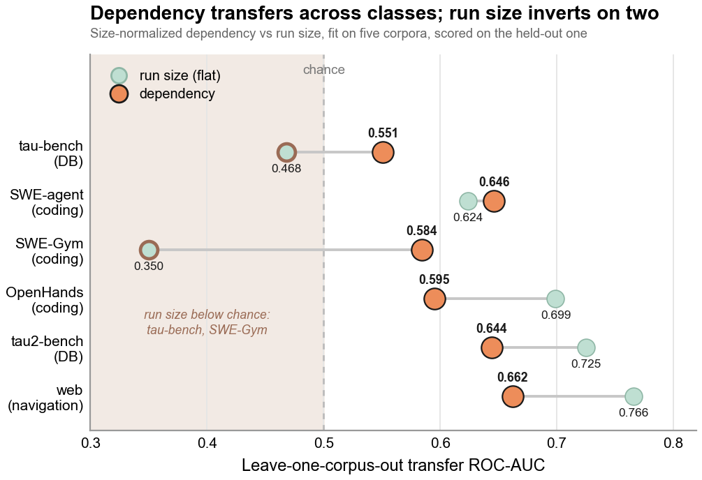
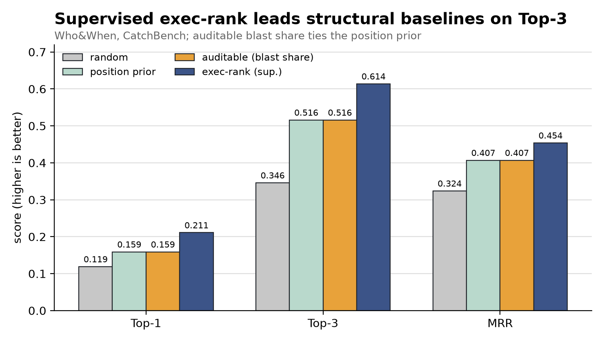

# POST: Rank a Finished Run, Find the Keystone

POST reads a run after it finished and produces a structural triage order. It scores every step by how much of the rest of the run leans on it, then names the keystone: the step that, if it went wrong, would have dragged the most of the run with it. This ordering is not a claim that the keystone is the fault or that it should precede other review evidence. On Who&When, the shipping blast-share ranker ties the position prior at displayed precision.

You hand `analyze_run` a finished run and read the keystone off the report:

```python
from auditable import analyze_run
from auditable.graph.adapters import tau_bench_prior_db_reads_v1

report = analyze_run(run, adapter=tau_bench_prior_db_reads_v1)
print(report.keystone.idx)   # the step the rest of the run rests on
```

The full runnable script is [`examples/example_post_rank_run.py`](https://github.com/yzhao062/auditable/blob/main/examples/example_post_rank_run.py); run it from a [source checkout](quickstart.md#running-the-examples) with `python examples/example_post_rank_run.py` (needs the `graph` extra). The [POST Examples](post-examples.md) page walks the output.

The per-run score POST prints is a within-run ranking, not a benchmark number. CatchBench evaluates the package's structural methods against labeled runs, summarized next.

## What CatchBench Establishes

The POST ranking reads the typed two-layer graph: a dependency layer (what each step relied on) over an execution layer (control flow). CatchBench scores named methods built from those layers against labeled agent runs.

- **Dependency features detect failed runs beyond run size on SWE-Gym.** `auditable (size+deps)` scores ROC-AUC 0.804 against 0.663 for `size (flat)`. Its paired comparisons with ECOD at 0.765 and GUARDIAN at 0.767 remain unresolved, so this board does not order those three methods.
- **Top-3 0.614 belongs to the supervised execution-feature ranker, not the package's blast-share ranker.** On Who&When (126 failed runs), GRADE's `exec-rank (sup.)` scores Top-3 0.614, MRR 0.454, and Top-1 0.211. The shipping `auditable (blast share)` method scores 0.516 / 0.407 / 0.159 and ties the position prior at displayed precision.





The transfer figure is GRADE's leave-one-corpus-out analysis; the method-specific values above are the current CatchBench board. The POST per-run keystone signal below is surfaced as an uncalibrated structural triage ranking rather than a calibrated probability.

The rest of this page is the reference for `analyze_run`, the `AnalysisReport` it returns, the no-score gates, and the caveats that travel with the score.

## Reference

POST needs the `graph` extra (NetworkX).

### `analyze_run`

```python
from auditable import analyze_run
from auditable.graph.adapters import tau_bench_prior_db_reads_v1

report = analyze_run(messages, adapter=tau_bench_prior_db_reads_v1)
print(report)
```

`analyze_run(source, *, adapter, ground=True)` is a top-level export. The `source` is whatever the adapter consumes (a public-corpus trajectory, or a chain of `auditable`'s own signed records). The `adapter` is any object satisfying the `Adapter` protocol. The call maps the source to typed steps, builds the `SessionGraph`, scores it structurally, grounds each step that states a model basis, and returns an `AnalysisReport`. Set `ground=False` to skip the (cheap, deterministic) grounding pass. See [Architecture](architecture.md) for the adapters and the typed graph.

### The Ranked Structural Signal

The per-step score is the normalized transitive blast share: of the rest of the run, how much transitively depends on this step. It is computed as `downstream_reach` over the dependency DAG, normalized by the number of other steps. A step that many later steps rest on scores high, because a fault there would propagate widely. This is the keystone signal.

The score is an uncalibrated structural triage ranking, not a calibrated probability. It orders steps by transitive blast share; it does not assert a likelihood that any step is wrong or establish an advantage over the position prior. Calibration would require labeled data and is not claimed here.

### The Keystone

The keystone is the worst-blast step: the one that the most of the run transitively rests on. It is surfaced as `AnalysisReport.keystone` (a `DecisionRisk` row) with `per_session` carrying its blast share (the run-level risk). The report's rendered summary names it directly and explains its position, for example "two consequential writes rest on this one read, so it heads the structural triage order."

The POST keystone is computed over the dependency DAG and is a distinct concept from the PRE execution keystone, which is a structural control-flow chokepoint over the `handoff_to` projection (see [PRE Rules](pre-rules.md)). The two are named separately in the code and must not be conflated.

### Reading the `AnalysisReport`

The report carries the fields you read:

| Field | What it holds |
|---|---|
| `state` | `scored`, `no_score:single_decision`, or `no_score:low_coverage`. |
| `ranked` | Every step as a `DecisionRisk`, highest structural risk first. In a no-score state the scores are `None` and the order is by index. |
| `keystone` | The worst-blast step, or `None` when the run is not scored. |
| `per_session` | The keystone's blast share, or `None`. |
| `coverage` | Dependency-edge coverage: the grade mix, the saturation ratio `rho`, and the observed fraction. |
| `grounding` | Per step index, the model-basis grounding where a basis is stated. |
| `completeness` | `complete` for an offline run. |
| `adapter` | The ingestion adapter id, so the report names the source that produced it. |
| `notes` | Plain-language honesty notes (covered below). |

Each `DecisionRisk` row carries the step's `idx`, `kind` (`decision` or `tool_call`), `agent`, `score` (or `None`), a short `label`, the typed `node_attrs`, and the `grounding` for that step when it states a checkable model basis. A corpus tool step states no model basis, so its grounding is `None` rather than a false zero; grounding lights up on records that carry a `decision_basis`, such as `auditable`'s own runs.

### The No-Score Gates

Two gates keep the score honest, and in both the scores are `None` rather than zero, so a withheld score never reads as no risk.

`no_score:single_decision` fires when a run has fewer than two steps. A single-decision run has no cross-decision structure to score, so the report degrades to the per-decision signals (the data and grounding signals) rather than inventing structure.

`no_score:low_coverage` fires when the dependency layer is too sparse, too inferred, or too saturated to score. When the observed fraction is below the threshold, or `rho` is near 1 (the full-history regime where dependency structure becomes a function of run size and adds nothing beyond the step count), the report withholds the score rather than present run size as risk. An empty dependency layer is low coverage by the same rule.

### The Caveats That Travel With the Score

The report's own `notes` carry the honesty caveats, and they should be stated wherever the POST keystone is shown:

- Read and write events are observed from the trace, but the corpus write-to-prior-read dependency edges are modeled: a conservative prior-read upper bound over the observed reads, not a causal label.
- The structural score is a ranking and triage signal, not calibrated.
- In a no-score state, the note states why the score was withheld (single decision, or low coverage), so a gated result still explains itself.
- When no step states a checkable model basis, the grounding note says so.

These caveats are part of the report, and they are the honest reading of the signal: a structural triage order over observed events and modeled dependency edges, not a calibrated probability of failure.
